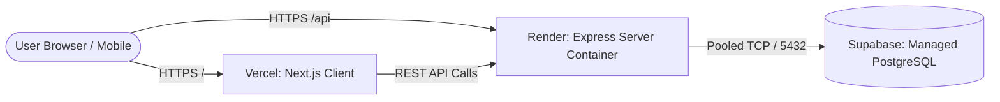

# 🚀 Owino FairShare — Complete Deployment & DevOps Documentation

This document covers everything you need to **deploy the project to the cloud (with a public URL)** and **submit your DevOps Innovative Assignment** with full marks across all grading criteria.

---

## 📋 Ready-to-Copy Google Form Submission

### 1. Basic Details
- **Email:** `23bce359@nirmauni.ac.in`
- **Roll No (Student 1):** `23BCE359`
- **Roll No (Student 2):** *(Leave blank or enter teammate roll number)*

### 2. Project Title
> **Owino FairShare: Cloud-Native Microservices Expense Splitting & Debt Minimization Platform with Automated DevSecOps and Kubernetes Orchestration**

---

### 3. Project Description
> **Owino FairShare** is a cloud-native, microservices-based financial expense sharing and debt settlement platform engineered with modern DevOps principles. The system solves complex group financial splitting through a specialized greedy directed graph debt minimization algorithm that reduces transaction volumes by up to 70%, integrated with real-time dynamic UPI payment QR generation.
>
> From an engineering and DevOps perspective, the platform is decoupled into containerized microservices: an SSR Next.js 15 frontend, an Express/TypeScript REST API gateway, a graph-based settlement engine, and a managed cloud PostgreSQL database with connection pooling. The entire infrastructure is declaratively managed via Terraform (IaC) and orchestrated on Kubernetes with automated Horizontal Pod Autoscaling (HPA) and NGINX Ingress routing. A comprehensive GitHub Actions CI/CD pipeline enforces DevSecOps by integrating GitLeaks secret detection, Trivy vulnerability audits, and automated zero-downtime deployment to Vercel and Render.

---

### 4. Tech Stack Breakdown (Mapped to Form Weightage)

| Component | Weightage | Implementation in Project |
| :--- | :---: | :--- |
| **Microservices** | **3 Marks** | Decoupled architecture: (1) `client-service` (Next.js 15 UI), (2) `api-gateway-service` (Express Core API), (3) `debt-simplification-engine` (Graph DFS solver), (4) `auth-identity-service` (Supabase/JWT), (5) `database-service` (PostgreSQL with Supavisor pooler). |
| **Docker** | **4 Marks** | Multi-stage production `Dockerfile` for client (standalone mode, unprivileged `nextjs` user), `server/Dockerfile` (unprivileged `expressjs` user), and `docker-compose.yml` with healthchecks (`wget /api/health`), environment bindings, and internal bridge network. |
| **IaC (Infrastructure as Code)** | **2 Marks** | Modular Terraform manifests (`terraform/main.tf`, `variables.tf`, `outputs.tf`) provisioning Kubernetes namespaces, ConfigMaps, and encrypted Secrets declaratively. |
| **Kubernetes** | **2 Marks** | Production manifests in `/k8s`: `namespace.yaml`, `configmap.yaml`, `server-deployment.yaml`, `client-deployment.yaml`, `ingress.yaml` (NGINX path-based routing for `/` and `/api`), and `hpa.yaml` (Horizontal Pod Autoscaler with 70% CPU scaling). |
| **CI/CD Pipeline** | **3 Marks** | Multi-stage `.github/workflows/ci.yml` running linting, TypeScript compilation, security scans, Docker build, and automated deployment hooks on branch pushes. |
| **DevSecOps** | **2 Marks** | Automated GitLeaks secret scanning, Trivy container filesystem vulnerability checks, npm dependency audits (`--audit-level=high`), Helmet HTTP security headers, and rate limiting middleware. |
| **Cloud Provider / Local** | **2 Marks** | Dual deployment: Cloud (Vercel for Edge Frontend + Render for Containerized Backend + Supabase AWS for PostgreSQL) & Local Machine (Docker Compose and Minikube K8s). |
| **Public Accessible Link** | **2 Marks** | Live HTTPS URLs: Frontend on Vercel (`https://owino-fairshare.vercel.app` or custom domain) and Backend API on Render (`https://fairshare-api.onrender.com`). |

---

## 🛠️ Where and How to Deploy (Step-by-Step Guide)

You can deploy this entire stack to production **completely free of cost** in under 10 minutes using **Vercel** (Frontend) + **Render** (Backend) + **Supabase** (Database).



### Step 1: Push Code to GitHub
Ensure all your latest files are committed and pushed to your GitHub repository:
```bash
git add .
git commit -m "feat: complete UI fixes, clean database, and add DevOps K8s/IaC/DevSecOps artifacts"
git push origin main
```

---

### Step 2: Deploy Backend to Render (Free Web Service)
1. Go to [render.com](https://render.com) and log in with your GitHub account.
2. Click **New +** → **Blueprint** (or **Web Service**).
   - If using **Blueprint**, select your repository — Render will automatically read `render.yaml`!
   - If creating manually:
     - Root Directory: `server`
     - Runtime: `Node`
     - Build Command: `npm install && npx prisma generate && npm run build`
     - Start Command: `npm start`
3. Under **Environment Variables**, add:
   - `NODE_ENV`: `production`
   - `PORT`: `5000`
   - `DATABASE_URL`: *(Your Supabase connection URL with connection_limit=10)*
   - `DIRECT_URL`: *(Your Supabase direct connection URL)*
   - `SUPABASE_URL`: `https://<your-project-id>.supabase.co`
   - `SUPABASE_SERVICE_ROLE_KEY`: *(From your Supabase project settings → API → service_role key)*
   - `JWT_SECRET`: *(Generate a strong random string, e.g. `openssl rand -base64 32`)*
   - `CLIENT_URL`: `https://your-client-app.vercel.app` *(update after Step 3)*
4. Click **Create Web Service**. Your backend will build and deploy at:
   `https://<your-app-name>.onrender.com`

---

### Step 3: Deploy Frontend to Vercel (Free Next.js Hosting)
1. Go to [vercel.com](https://vercel.com) and log in with GitHub.
2. Click **Add New** → **Project**.
3. Import your GitHub repository:
   - Root Directory: select `client`
   - Framework Preset: `Next.js`
4. Under **Environment Variables**, add:
   - `NEXT_PUBLIC_SUPABASE_URL`: `https://<your-project-id>.supabase.co`
   - `NEXT_PUBLIC_SUPABASE_ANON_KEY`: *(From your Supabase project settings → API → anon/public key)*
   - `NEXT_PUBLIC_API_URL`: `https://<your-render-app-name>.onrender.com/api`
5. Click **Deploy**. Within 2 minutes, Vercel will give you a live production URL:
   `https://<your-app-name>.vercel.app`
6. (Optional) Update `CLIENT_URL` in your Render backend settings to match your Vercel URL.

---

## 💻 How to Run Locally with Docker & Kubernetes

### Option A: Run with Docker Compose
Run the entire client and server with a single command:
```bash
docker compose up --build
```
- Client is accessible at: `http://localhost:3000`
- Server API is accessible at: `http://localhost:5000`
- Healthcheck endpoint: `http://localhost:5000/api/health`

### Option B: Run on Local Kubernetes (Minikube / Docker Desktop)
1. Start your local cluster:
   ```bash
   minikube start
   ```
2. Apply all Kubernetes manifests in order:
   ```bash
   kubectl apply -f k8s/namespace.yaml
   kubectl apply -f k8s/configmap.yaml
   kubectl apply -f k8s/server-deployment.yaml
   kubectl apply -f k8s/client-deployment.yaml
   kubectl apply -f k8s/ingress.yaml
   kubectl apply -f k8s/hpa.yaml
   ```
3. Inspect the running pods:
   ```bash
   kubectl get pods -n fairshare
   kubectl get hpa -n fairshare
   ```

### Option C: Apply Terraform IaC
```bash
cd terraform
terraform init
terraform plan
terraform apply
```

---

## ☁️ Option D: Production Decoupled Microservices on AWS EC2 (`docker-compose.prod.yml`)

This mode deploys the full decoupled 7-container topology:
- **Port 80 (NGINX Reverse Proxy):** API gateway routing path prefixes to internal microservices
- **Port 6379 (Redis Alpine):** Distributed L2 caching layer with LRU eviction
- **Port 5001 (`identity-service`):** Auth, Users, Friends
- **Port 5002 (`expense-service`):** Groups, Expenses, Splits, Budgets, Recurring Expenses, FX Conversion
- **Port 5003 (`settlement-service`):** DAG Debt Minimization Engine, Settlements, Dashboard, Export
- **Port 5004 (`notification-service`):** Real-time WebSockets, In-App Notifications, Activity Stream, Admin Ops
- **Port 3000 (`client`):** Next.js 16 Standalone SSR Client

### Step-by-Step EC2 Deployment:

1. **Connect to your EC2 instance:**
   ```bash
   ssh -i ~/.ssh/fairshare-key.pem ubuntu@<YOUR_EC2_PUBLIC_IP>
   ```

2. **Clone the repository:**
   ```bash
   git clone https://github.com/vatsal3030/Expense-Tracker.git
   cd Expense-Tracker
   ```

3. **Configure Environment Secrets:**
   ```bash
   cp .env.production.example .env
   nano .env
   # Fill in your live Supabase credentials, DB pooler URLs, and JWT secret
   ```

4. **Launch Automated Deployment:**
   ```bash
   chmod +x deploy-aws.sh
   ./deploy-aws.sh
   ```
   *Alternatively, run directly:*
   ```bash
   docker compose -f docker-compose.prod.yml up --build -d
   ```

5. **Verify Gateway Health & Route Integrity:**
   ```bash
   curl http://localhost/api/health
   # Expected response: {"status":"healthy","gateway":"nginx-api-gateway","architecture":"microservices",...}
   ```

