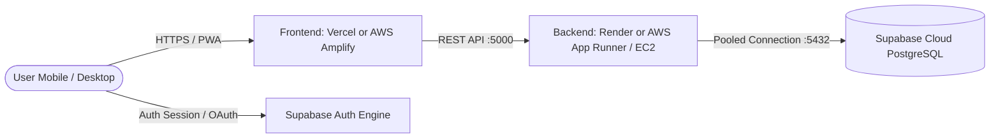

# 🚀 Owino — Cloud & Production Deployment Guide

This guide provides step-by-step instructions for deploying **Owino** to **AWS**, **Vercel**, and **Render** using free tier options.

---

## 1. Architecture Overview



---

## 2. AWS Deployment (Free Tier & Credits)

Since you have an AWS account with free tier credits, you have two optimal paths:

### Option A: AWS App Runner (Recommended — Fully Managed Containers)
AWS App Runner automatically builds and runs containerized applications with zero infrastructure management and automatic SSL.

#### 1. Deploy the Backend API
1. Open the [AWS App Runner Console](https://console.aws.amazon.com/apprunner).
2. Click **Create service**.
3. Under **Repository type**, choose **Source code repository** and link your GitHub repository: `https://github.com/vatsal3030/Expense-Tracker`.
4. Set the branch to `main`.
5. Configuration:
   - **Runtime**: Node.js 20
   - **Build command**: `cd server && npm ci && npx prisma generate && npm run build`
   - **Start command**: `cd server && npm start`
   - **Port**: `5000`
6. Add Environment Variables:
   - `NODE_ENV`: `production`
   - `PORT`: `5000`
   - `CLIENT_URL`: `https://your-frontend-domain.vercel.app` (or your AWS domain)
   - `DATABASE_URL`: `postgresql://postgres:<your-db-password>@<your-db-host>:5432/postgres?sslmode=require&connection_limit=20`
   - `DIRECT_URL`: `postgresql://postgres:<your-db-password>@<your-db-host>:5432/postgres`
   - `SUPABASE_URL`: `https://<your-project-id>.supabase.co`
   - `SUPABASE_ANON_KEY`: `your_anon_key`
   - `SUPABASE_SERVICE_ROLE_KEY`: `your_service_role_key`
   - `JWT_SECRET`: `your_secure_jwt_secret`
7. Click **Create & Deploy**. App Runner will provide an HTTPS endpoint like `https://xyz.awsapprunner.com`.

---

### Option B: AWS EC2 (Docker Compose Deployment)
If you prefer running both containers together on a single VM within the Free Tier:

1. Launch an **EC2 Instance**:
   - AMI: Ubuntu 24.04 LTS (t3.micro or t4g.small)
   - Security Group: Allow ports `22` (SSH), `80` (HTTP), `443` (HTTPS), `3000`, `5000`.
2. Connect to EC2 via SSH and install Docker:
   ```bash
   sudo apt update && sudo apt install -y docker.io docker-compose git
   sudo usermod -aG docker ubuntu
   ```
3. Clone the repository:
   ```bash
   git clone https://github.com/vatsal3030/Expense-Tracker.git
   cd Expense-Tracker
   ```
4. Create `.env` in the root folder with your credentials.
5. Start the containers:
   ```bash
   docker-compose up -d --build
   ```
6. Check health:
   ```bash
   curl http://localhost:5000/api/health
   ```

---

## 3. Vercel Deployment (Frontend)

1. Go to [Vercel](https://vercel.com) and click **Add New > Project**.
2. Select your repository `vatsal3030/Expense-Tracker`.
3. Set **Root Directory** to `client`.
4. Configure Environment Variables:
   - `NEXT_PUBLIC_SUPABASE_URL`: `https://eqtmygiizyehikodaxpe.supabase.co`
   - `NEXT_PUBLIC_SUPABASE_ANON_KEY`: `your_supabase_anon_key`
   - `NEXT_PUBLIC_API_URL`: `https://your-backend-service.onrender.com/api` (or your AWS App Runner URL)
5. Click **Deploy**. Vercel will build the standalone Next.js application and assign an SSL domain.

---

## 4. Render Deployment (Backend API)

1. Sign in to [Render](https://render.com).
2. Click **New > Blueprint**.
3. Select your repository `vatsal3030/Expense-Tracker`.
4. Render automatically detects `render.yaml` and sets up the Node.js Express service.
5. In the Render Dashboard, confirm the secret environment variables (`DATABASE_URL`, `SUPABASE_SERVICE_ROLE_KEY`, `JWT_SECRET`).
6. Click **Apply**.

---

## 5. Verification Checklist

- [ ] Health check returns `"status": "healthy"` on `/api/health`.
- [ ] PWA installs on mobile with Owino icon.
- [ ] OAuth providers (Google / GitHub) redirect to `${CLIENT_URL}/auth/callback`.
- [ ] Group invite links (`/groups/join/[id]`) correctly authenticate and admit users.
