# 🏗️ Information Architecture & Route Inventory: Owino (FairShare)

**Document:** `INFORMATION_ARCHITECTURE.md`  
**Version:** 2.0  
**Scope:** Navigation Systems, Page Hierarchy, and Route Inventory  

---

## 1. Global Navigation Architecture

The navigation architecture is organized into three distinct tiers:

```mermaid
graph TD
    Root["App Root"] --> Public["1. Public Zone\n(Marketing, Legal, Auth)"]
    Root --> App["2. Core SaaS Application\n(Authenticated Dashboard)"]
    Root --> Utility["3. Quick Actions\n(Add Bill, Settle Up)"]

    Public --> Landing["/ (Landing Page)"]
    Public --> Login["/login"]
    Public --> Signup["/signup"]
    Public --> LegalTerms["/legal/terms"]
    Public --> LegalPrivacy["/legal/privacy"]
    Public --> Compare["/compare/splitwise"]

    App --> Dashboard["/dashboard (Net Financial Summary)"]
    App --> Expenses["/expenses (Full Paginated Ledger)"]
    App --> SplitBill["/split-bill (Dedicated Bill Splitting)"]
    App --> Groups["/groups (Group Containers & DAG Balances)"]
    App --> Settlements["/settlements (Bilateral Debts & QR)"]
    App --> Reports["/reports (Exports & Auditing)"]
    App --> Friends["/friends (Connections & Invites)"]
    App --> Settings["/settings (Preferences & Profile)"]
```

---

## 2. Complete Route Inventory

| Route | Page Title | Primary Purpose | Key Components | Mobile Responsive Pattern |
|---|---|---|---|---|
| `/` | Landing Page | Introduce product, interactive demo, social proof, zero-slop comparison | Hero, Live Demo Widget, Comparison Table, FAQ, Footer | Single-column linear scroll with sticky CTA |
| `/login` | Sign In | Authenticate returning users | Clean 2-field form, Google OAuth, Password reset | Centered card, auto-focus input |
| `/signup` | Sign Up | Fast new user onboarding | Name, Email, Password, Terms confirmation | Centered card with instant validation |
| `/dashboard` | Dashboard | At-a-glance financial snapshot | Net Balance Card, Active Groups, Recent Activity, Pending Settlements | High-priority balance header + vertical card stack |
| `/expenses` | All Expenses | Comprehensive transaction log | Search filter, Category filter, Paginated expense table | Infinite scroll / 30-item paginated card list |
| `/expenses/new` | Add Expense | Fast bill entry | Amount input, Payer selector, Split type toggles | Full-screen mobile view, numeric keypad default |
| `/split-bill` | Split Bill | Dedicated multi-person split | Dynamic participant sliders/inputs, exact share math | Thumb-friendly vertical member checklist |
| `/groups` | Groups | Group expense management | Group cards with member avatars, net balances, 1-click import | 2-column grid on desktop, single stack on mobile |
| `/groups/[id]` | Group Detail | Detailed group ledger & balances | Simplified Debt DAG summary, member list, group expenses | Sticky bottom action bar `[+ Add Bill]` |
| `/settlements` | Settlements | Finalize debts & generate UPI QR | Bilateral debt list, Dynamic QR modal, Confirmation status | Direct "Pay with UPI" deep-link sheet |
| `/reports` | Reports & Export | Download tax/trip statements | Date range picker, Category breakdown charts, CSV export | Responsive summary cards + CSV download button |
| `/friends` | Friends | Peer-to-peer balance ledger | Friend balance list, Invite link generator, QR share | Clean contact list format with balance chips |
| `/settings` | Settings | Profile, Currency, Security | Currency selector, Notification toggles, Theme switch | Segmented settings groups |
| `/legal/privacy` | Privacy Policy | Clear data privacy disclosures | Formatted legal prose, data retention notice | Readability-optimized editorial layout |
| `/legal/terms` | Terms of Service | Service terms and disclaimers | Formatted terms prose | Readability-optimized editorial layout |

---

## 3. Responsive Navigation Behavior

- **Mobile Viewports (< 768px):**
  - High-speed bottom navigation bar with 4 primary destinations:
    - 🏠 **Dashboard**
    - 👥 **Groups**
    - ➕ **Add Bill** (Elevated center action button)
    - 💳 **Settlements**
  - Top header displays current profile avatar and quick notification bell.
- **Desktop Viewports (≥ 768px):**
  - Sleek, compact left sidebar with clean text labels, intuitive icon pairings, and active route indicators.
  - Generous content max-width (1280px) to prevent stretched, unreadable lines.
