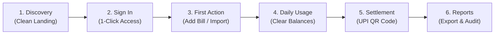

# 🗺️ User Journey Map: Owino (FairShare)

**Document:** `USER_JOURNEY_MAP.md`  
**Version:** 2.0  
**Scope:** End-to-End User Experience from Discovery to Instant UPI Settlement  

---

## Stage-by-Stage Journey Architecture

---

### Stage 1: Discovery (Landing Page)
- **User Action:** Arrives at website via recommendation or search.
- **User Objective:** Understand what Owino is in 5 seconds.
- **Potential Friction in Old UI:** Wall of text, confusing buzzwords ("Quantum AI Ledgers"), dark heavy cyberpunk visuals that feel unfamiliar to non-technical users.
- **V2 Solution:** 
  - Plain English headline: **"Split group bills in seconds. Settle up with instant UPI. 100% Free with zero limits."**
  - Interactive live demo card right in the hero section: change bill from ₹1,200 to ₹3,000 and see 3 friends' shares update in real-time.
  - Smooth Lenis scrolling and soft entrance animations (`motion`) without lag.

### Stage 2: Registration & Sign In
- **User Action:** Clicks "Get Started Free" or "Sign In".
- **User Objective:** Enter dashboard in under 10 seconds.
- **Potential Friction in Old UI:** Redirect loops, hash-based URLs (`/#`), ambiguous error messages.
- **V2 Solution:** 
  - Clean two-field login or 1-tap Google authentication.
  - Instant transition directly to `/dashboard`.

### Stage 3: Onboarding & First Action
- **User Action:** User creates their first group or imports from Splitwise.
- **User Objective:** Migrate old expenses or set up a flatmate group.
- **Potential Friction in Old UI:** Splitwise CSV import timeout on 2,000 expenses; popup modal overflowing screen edges on mobile.
- **V2 Solution:** 
  - Dedicated full-page Splitwise migration engine with progress bar and instant deduplication.
  - Simple 2-field "Create Group" dialog (Name + Currency).

### Stage 4: Daily & Regular Usage (Adding an Expense)
- **User Action:** Records dinner, cab, or groceries.
- **User Objective:** Log who paid and who was involved.
- **Potential Friction in Old UI:** Cluttered modal showing 12 tiny member checkboxes; lagging dropdowns.
- **V2 Solution:**
  - Dedicated `/expenses/new` page or crisp bottom sheet on mobile.
  - Fast smart defaults (Splits equally among all members by default; 1 tap to customize).
  - Clear receipt/notes field.

### Stage 5: Debt Minimization & Settlement
- **User Action:** User wants to clear their debt before month-end.
- **User Objective:** Pay their share and get confirmation.
- **Potential Friction in Old UI:** Complex graph diagrams, hidden buttons, unclear UPI IDs.
- **V2 Solution:**
  - Big prominent **"You Owe Rahul ₹450"** card.
  - Click **"Settle Up via UPI"** -> Instantly shows dynamic QR code + deep-link for PhonePe, GPay, Paytm.
  - Once paid, 1-tap confirmation marks the balance settled across both users in real-time.

### Stage 6: Retention & Periodic Review
- **User Action:** End of month review or tax/trip accounting.
- **User Objective:** Export clean CSV or PDF summary.
- **V2 Solution:**
  - Fast, server-paginated `/reports` and `/expenses` with instant search.
  - 1-click CSV download formatted cleanly for Excel or Google Sheets.
